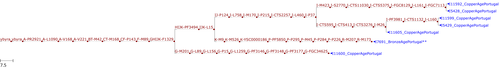
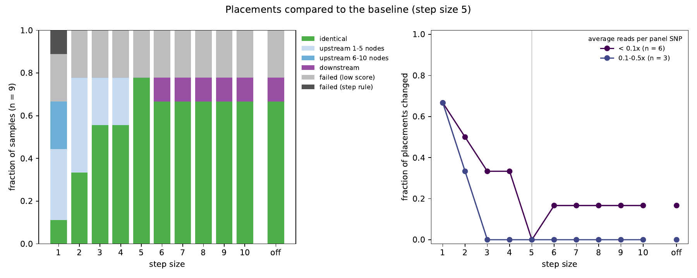
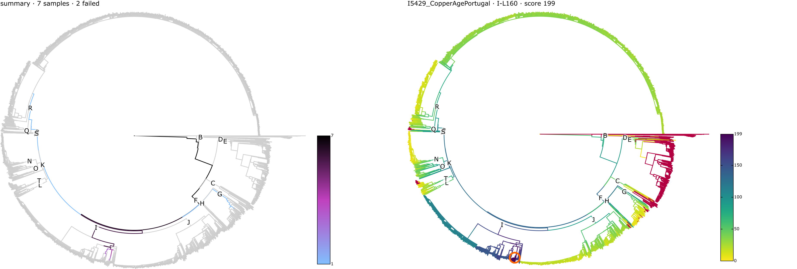

# ybyra example

A complete, ready-to-run example of ybyra on ancient DNA samples. All data needed to run it is included in this folder.

## Data

The `bams/` folder contains nine ancient Portuguese males from the Copper Age and Bronze Age, published in

> Olalde et al. (2019). The genomic history of the Iberian Peninsula over the past 8000 years.<br />
> *Science* 363(6432), 1230–1234. DOI:[10.1126/science.aav4040](https://doi.org/10.1126/science.aav4040)

These are 1240k capture data of half-UDG treated libraries, mapped to hg37. To keep the files small, we already extracted the Y chromosome from the published bam files (`samtools view <bam> Y`) and indexed them.

The `units.tsv` lists these samples, and `config.yaml` contains the settings for this example: hg37 with the FamilyTreeDNA tree, and the ancient DNA damage filter with the bidirectional damage model. All other settings are the defaults from `config/config.yaml`.

## Reference genome

ybyra needs the reference genome that the bam files are mapped to, here hs37d5 (hg37). As ybyra only uses the Y chromosome, the example ships with a reduced reference in `ref/`, containing only the Y chromosome, so that no large download is needed. This is for demonstration purposes only; for your own data, simply use the full reference genome that your bam files are mapped to.

We created the reduced reference from the full genome ([`hs37d5.genome.tgz` on Zenodo](https://zenodo.org/records/8045374)) as follows:

```
wget -O hs37d5.genome.tgz "https://zenodo.org/records/8045374/files/hs37d5.genome.tgz?download=1"
tar xzf hs37d5.genome.tgz
samtools faidx hs37d5/hs37d5.fa Y | bgzip > ref/hs37d5.Y.fa.gz
samtools faidx ref/hs37d5.Y.fa.gz
```

To run the example with the full reference genome instead, run the first two commands above within this `example/` folder, and set `ref_genome: "hs37d5/hs37d5.fa"` in `config.yaml`. The results are identical. Note that ybyra only needs the fasta file and its `.fai` index; no mapping index is needed.

## Run

Install the ybyra environment and activate it as described in the [main README](../README.md#requirements). Then, from the main ybyra directory, run:

```
snakemake --cores 4 --directory example
```

The results are written to this `example/` folder; see the [main README](../README.md#main-output-files) for a description of the output files.

## Expected results

The resulting `aggregate.yplace` should be identical to `expected_aggregate.yplace` in this folder, and `aggregate.pdf` should look like this:



Seven of the nine samples are placed in `aggregate.yplace`. Six of them are placed confidently (no flags, shown as `...`): five in haplogroup I (I-FGC7113, I-L160, I-M26) and one in G (G-FGC34625).

The low-coverage sample I7691 is only placed at R-M173, with a tree score of 16 (marked with `**` in the plot). Three nodes within R-M269 tie for the highest score, each supported by a single derived SNP (see `score_ties.yplace`). Their common ancestor R-M269 however fails the step rule (see `step_rule_nopass.yplace`), so the placement falls back to R-M173, hence the flags `low_tree_score;score_tie;most_recent_common_parent;step_rule`.

The two samples with the lowest coverage, I11604 and I7687, have a tree score below 10, and are hence not placed, but listed in `fail.yplace` instead.

## Exploring the step size

To see how the [step rule](../README.md#exploring-the-step-size) affects the placements, set the following line in `config.yaml` and run the example again:

```
step_size_exploration: true
```

The results are written to `step_size/` in this folder. The overview plot `step_size/overview.pdf` should look like this:



The left panel shows, for each step size, how the placements compare to those at the default step size of 5. With step sizes 1 to 4, more samples are placed upstream, and at step size 1, I7691 fails the step rule. With step sizes of 6 and above, and without the step rule ("off"), only I7691 changes: it is placed downstream at R-M269 instead of R-M173. The right panel shows the fraction of samples whose placement changes, split by sample depth.

This is a small example with nine low-coverage samples, so it is not representative of a typical dataset. In particular, the two samples I11604 and I7687 have too little data to be placed at any step size, which is why each bar has a large gray "failed (low score)" part. Samples with higher coverage are less affected by the step size, as the right panel shows already for the three samples with more than 0.1 average reads per panel SNP.

`step_size/samples.pdf` shows the placements of all samples that change with the step size, and `step_size/step_size.tsv` lists the placements of all samples at all step sizes.

## Plotting with ybyrapûera

Our plotting tool [ybyrapûera](../puera/) (`puera`) draws publication-ready SVG trees of the results. Build it as described in its README, and then run, from the main ybyra directory:

```
puera/bin/puera sample \
    --tree-table-file trees/ftdna/ftdnaY.oct25.complete.tree \
    --snps-table-file trees/ftdna/hg37/ftdnaY.oct25.hg37.tsv \
    --clade-labels-file trees/ftdna/ftdnaY.oct25.labels.tsv \
    --ybyra-dir example \
    --exclude-damage \
    --out-dir example/plots

puera/bin/puera summary \
    --tree-table-file trees/ftdna/ftdnaY.oct25.complete.tree \
    --snps-table-file trees/ftdna/hg37/ftdnaY.oct25.hg37.tsv \
    --clade-labels-file trees/ftdna/ftdnaY.oct25.labels.tsv \
    --ybyra-dir example \
    --out-dir example/plots
```

The tree and SNP table are the ones of the FamilyTreeDNA tree used in this example, and `--exclude-damage` matches the `damage_filter: true` setting in `config.yaml`. This writes one tree per sample, and a summary tree of all samples, to `example/plots/`. The summary (left) and the tree of sample I5429 (right) look like this:



The summary colors each branch by the number of samples placed in its clade. Here, six samples are in haplogroup I, one in G, and I7691 in R. The sample tree colors each branch by the tree score of the sample, with negative scores in red, and marks the placement I-L160 with a ring.
